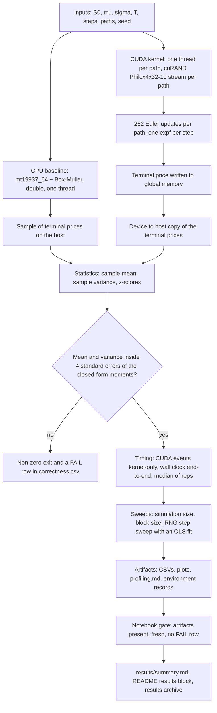
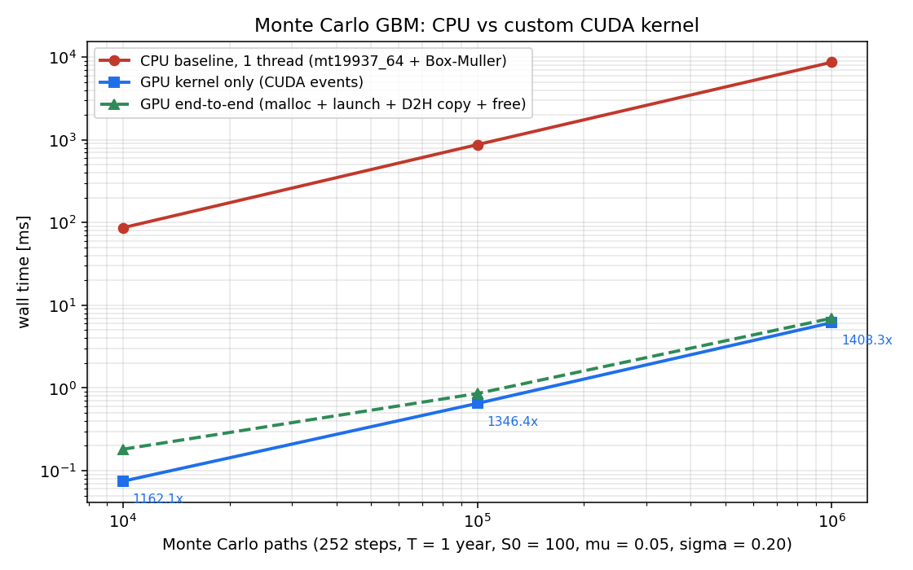
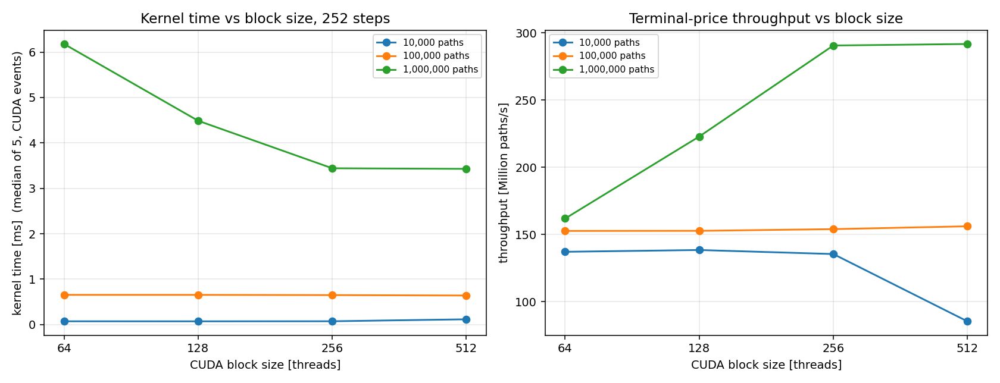
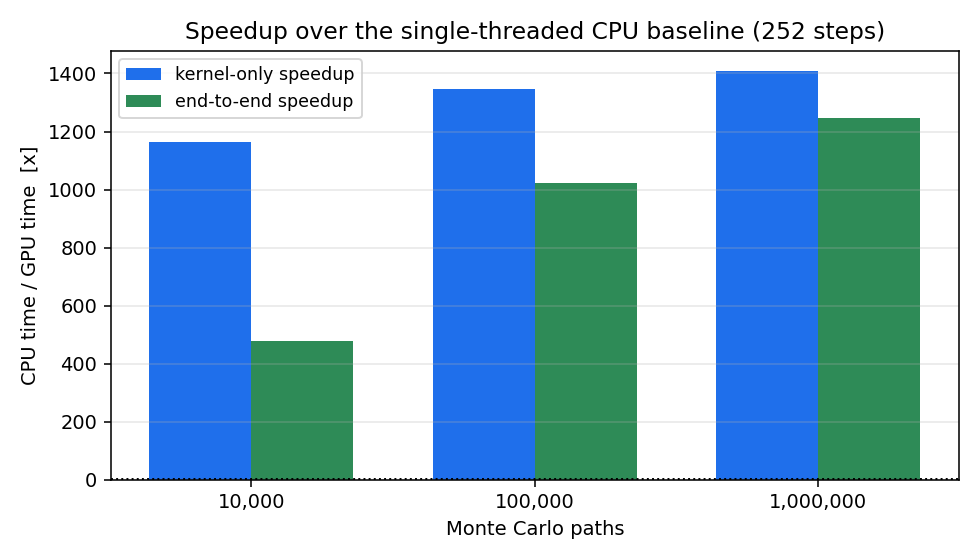

# CUDA Monte Carlo GBM Stock-Price Simulator

[](https://isocpp.org/)
[](https://developer.nvidia.com/cuda-toolkit)
[](https://www.nvidia.com/en-us/data-center/tesla-t4/)
[](https://www.kaggle.com/)

A from-scratch Monte Carlo simulator for geometric Brownian motion (GBM) stock prices: a hand-written
CUDA kernel with one thread per price path, a single-threaded CPU baseline, an analytical correctness
harness, and a benchmark and profiling workflow that runs end to end in one Kaggle GPU notebook. One
source file, a 70-line Makefile, no dataset, no framework.

The GBM update rule is textbook; the effort here went into the measurement — separating kernel latency
from end-to-end time, validating against closed-form moments with analytical standard errors, and
backing every number in this README with an artifact in `results/`, including what could *not* be
measured in a shared container.

## Overview

- **Model.** `S(t+dt) = S(t)·exp((mu − 0.5σ²)dt + σ√dt·Z)`, `Z ~ N(0,1)`, `dt = T/steps`; terminal
  price `S(T)` only, one GPU thread per path, 252 Euler steps per path.
- **Randomness.** cuRAND Philox4x32-10 with an independent stream per path on the GPU
  (`curand_init(seed, path_id, 0)`); `std::mt19937_64` + Box–Muller in `double` on the CPU.
- **Timing.** CUDA events for kernel-only time; wall clock for end-to-end time including allocation,
  launch and the device→host copy; medians over repeated runs at a fixed seed.
- **Validation.** Sample mean and variance against the exact log-normal moments, scored as z-scores
  with analytical standard errors.

## Workflow



Both backends run the same path count, step count, parameters and seed policy, so the two columns of
the benchmark tables are the same work on different hardware.

## Repository layout

```
src/gbm_montecarlo.cu                     CPU baseline + CUDA kernel + correctness + benchmark + CLI
notebooks/kaggle_gbm_montecarlo.ipynb     5-cell Kaggle workflow, embedding the source verbatim
results/                                  measured artifacts, committed as evidence
tools/                                    notebook builder, test suites, results-archive auditor
Makefile                                  nvcc / g++ build and check targets
```

`src/gbm_montecarlo.cu` is deliberately one translation unit: one kernel plus one baseline, compiled
with the same parameters and driven by the same harness, so the comparison cannot drift.

`tools/` holds the notebook builder, the notebook validator (every cell parses, embedded source
byte-identical to `src/`), three test suites (packaging gate, profiling parsers, whole profiling
ladder), and `check_results_zip.py`, which audits a downloaded results archive.

## Build and run

```bash
make                      # nvcc -O3 -std=c++17 -arch=sm_75 -Xptxas -v -lineinfo -lcurand
make ARCH=sm_60           # Tesla P100        make ARCH=sm_80   # A100
make cpu                  # CPU-only baseline, no CUDA toolkit needed, GPU columns become -1

./build/gbm smoke
./build/gbm verify --paths 200000 --seeds 3 --steps 252 --out results
./build/gbm bench  --sizes 10000,100000,1000000 --blocks 64,128,256,512 \
                   --steps 252 --reps 5 --cpu-reps 3 --ref-block 256 --out results
./build/gbm rng    --paths 1000000 --block 256 --steps 1,4,16,64,252 --reps 5 --out results
```

`make verify` / `bench` / `rng` / `smoke` / `info` wrap those commands. Checks that need no GPU at
all: `make check` (notebook validation + CPU-only correctness), `make nbtest`, `make proftest`,
`make checkzip ZIP=…`.

## The model

With `dt = T/steps` and `Z ~ N(0,1)`:

```
S(t+dt) = S(t) * exp((mu - 0.5*sigma^2)*dt + sigma*sqrt(dt)*Z)
E[S(T)^k] = S0^k * exp(k*mu*T + 0.5*k*(k-1)*sigma^2*T)      # closed-form oracle
```

The Euler scheme is **exact in distribution** for the terminal value at any `steps >= 1`, because the
log-increments of GBM are independent Gaussians — so the step count is an invariance to test, not an
approximation error. With `S0=100, mu=0.05, sigma=0.20, T=1` the harness expects
`E[S(T)] = 105.127110`, `sd = 21.237439`.

## Implementation

**CPU baseline.** `std::mt19937_64` + Box–Muller (both `sin`/`cos` outputs used, so one `log`+`sqrt`+
`sin`+`cos` block gives two deviates), all arithmetic in `double`, timed around the simulation loop
only. Single-threaded on purpose: the comparison is one-path-at-a-time versus one-path-per-thread.

**CUDA kernel.**

```cpp
__global__ void gbm_terminal_price_kernel(float* __restrict__ out, const long long n_paths,
                                         const int steps, const float S0, const float drift,
                                         const float vol, const unsigned long long seed) {
  const long long i = (long long)blockIdx.x * blockDim.x + threadIdx.x;
  if (i >= n_paths) return;                             // any path count, incl. non-multiples
  curandStatePhilox4_32_10_t st;
  curand_init(seed, (unsigned long long)i, 0ULL, &st);  // one independent stream per path
  float s = S0;
  const int pairs = steps >> 1;
#pragma unroll 4
  for (int k = 0; k < pairs; ++k) {
    const float2 z = curand_normal2(&st);               // two N(0,1) deviates per counter step
    s *= expf(drift + vol * z.x);
    s *= expf(drift + vol * z.y);
  }
  if (steps & 1) { const float z = curand_normal(&st); s *= expf(drift + vol * z); }
  out[i] = s;
}
```

| Choice | Why |
|---|---|
| one thread per path | no communication, no atomics, no shared memory: pure RNG + arithmetic |
| `curand_init(seed, path_id, 0)` | independent stream per path and bitwise reproducibility per `(seed, paths, block)` |
| `curand_normal2` + `#pragma unroll 4` | halves RNG counter traffic and lets the compiler overlap the `expf` pipeline |
| `i >= n_paths` guard | arbitrary path counts, e.g. 1000 paths at block 256 leaves 24 lanes masked |
| one `cudaMalloc` + one `cudaMemcpy` | only the terminal price crosses the bus; no per-step traffic |
| explicit error check + synchronisation | a kernel fault can never be mistaken for a fast timing |

The binary uses **28 registers/thread, 0 bytes stack, 0 spill stores, no local memory**
(`-Xptxas -v`, `cuobjdump -res-usage`; see `results/compile_log.txt`), so the inner loop is
register-resident — what a one-thread-per-path stencil needs.

## Correctness

`./build/gbm verify` writes `results/correctness.csv` and exits non-zero on any failure. The recorded
run used **200 000 paths, 252 steps, 3 seeds** and reported **31 PASS, 0 FAIL, 3 skipped by design**;
the largest `\|z\|` anywhere in the CSV is **2.14** against a limit of 4.

| Check | Backend | Tolerance |
|---|---|---|
| `output_valid` — size, all finite, all > 0 | CPU + GPU | exact |
| `mean_vs_analytic`, `variance_vs_analytic` | CPU + GPU | `\|z\| < 4`, analytical s.e. (variance s.e. from the exact central 4th moment) |
| `mean_cpu_vs_gpu` — two-sample comparison | cross | `\|z\| < 4`, `s.e. = sqrt(2)·s.e.(mean)` |
| `determinism_same_seed` / `different_seed_differs` | GPU | max difference exactly 0 / > 0 |
| `single_path`, `zero_paths`, `non_divisible_paths` | CPU + GPU | exact (masking, no launch, 1000 paths at block 256) |
| `steps_invariance` — `steps ∈ {1, 21, 252}` | GPU | `\|z\| < 4`; `E[S(T)]` must not depend on step count |

`|z| < 4` is a ~1e-4 two-sided false-failure rate for a correct implementation. Element-by-element
CPU/GPU agreement is deliberately **not** required — the backends use different generators and
precisions and draw different normal streams — so those rows are recorded as *skipped by design*
rather than as a passed comparison. The GPU is bitwise reproducible per `(seed, paths, block)`; across
implementations only the distribution is. The harness earned its place by catching a wrong
raw-moment formula (log-drift `mu` instead of `mu − 0.5σ²`) that biased `E[S(T)]` by 2% and produced
`z ≈ −32` on every mean check.

## Benchmarks

**Methodology.** Compile, then a warm-up run of the same geometry; **kernel-only** time from
`cudaEventRecord` around the launch with `cudaEventSynchronize`; **end-to-end** time around
`cudaMalloc` → launch → device→host copy → `cudaFree`; every repetition does identical work (fixed
seed) and the reported value is the median (CPU 3 reps, GPU 5 reps). Speedup is `CPU time / GPU time`.
Parameters: `S0=100, mu=0.05, sigma=0.20, T=1`, 252 steps.

<!-- RESULTS:START -->
GPU: Tesla T4 (compute capability 75) | CPU: Intel(R) Xeon(R) CPU @ 2.00GHz (4 logical cores) | nvcc: /usr/local/cuda/bin/nvcc

Simulation: S0=100, mu=0.05, sigma=0.20, T=1 year, 252 steps, terminal price only;
timings are medians (CPU: 3 reps, GPU: 5 reps) from CUDA events on a single Kaggle GPU.

### CPU vs GPU over simulation size (block size 256)

| paths | steps | block | CPU ms | GPU kernel ms | GPU e2e ms | speedup (kernel) | speedup (e2e) | GPU paths/s |
|---|---|---|---|---|---|---|---|---|
| 10,000 | 252 | 256 | 86.50 | 0.074 | 0.181 | 1162.1x | 477.2x | 1.344e+08 |
| 100,000 | 252 | 256 | 875.11 | 0.650 | 0.856 | 1346.4x | 1022.1x | 1.538e+08 |
| 1,000,000 | 252 | 256 | 8684.63 | 6.167 | 6.966 | 1408.3x | 1246.7x | 1.622e+08 |

### GPU kernel time and throughput vs CUDA block size

| paths | block | GPU kernel ms | GPU e2e ms | GPU paths/s | reps |
|---|---|---|---|---|---|
| 10,000 | 64 | 0.073 | 0.199 | 1.371e+08 | 5 |
| 10,000 | 128 | 0.072 | 0.177 | 1.385e+08 | 5 |
| 10,000 | 256 | 0.074 | 0.177 | 1.355e+08 | 5 |
| 10,000 | 512 | 0.117 | 0.218 | 8.543e+07 | 5 |
| 100,000 | 64 | 0.655 | 0.858 | 1.526e+08 | 5 |
| 100,000 | 128 | 0.655 | 0.891 | 1.527e+08 | 5 |
| 100,000 | 256 | 0.649 | 0.873 | 1.540e+08 | 5 |
| 100,000 | 512 | 0.641 | 0.860 | 1.561e+08 | 5 |
| 1,000,000 | 64 | 6.178 | 7.046 | 1.619e+08 | 5 |
| 1,000,000 | 128 | 4.488 | 4.300 | 2.228e+08 | 5 |
| 1,000,000 | 256 | 3.442 | 4.307 | 2.905e+08 | 5 |
| 1,000,000 | 512 | 3.429 | 4.190 | 2.916e+08 | 5 |

### RNG setup / launch-overhead fit

```
OLS fit over the step sweep (kernel-only CUDA-event timings)
  t_ms(steps) = a + b*steps
  a = 0.029312 ms   fixed per-launch cost (kernel launch + curand_init for all 1000000 paths)
  b = 0.00985581 ms   marginal cost of one extra step for all 1000000 paths
  R^2 = 0.999984  (points = 5)
  at 252 steps: a + 252*b = 2.512977 ms, of which 1.2% is fixed setup overhead
  per-path curand_init+launch cost ~ a / n = 0.0293 ns
```

Raw data: `results/benchmark_sizes.csv`, `results/benchmark_blocks.csv`, `results/rng_overhead.csv`. Plots: `results/plot_cpu_vs_gpu_time.png`, `results/plot_block_sizes.png`, `results/plot_speedup.png`.

<!-- RESULTS:END -->

### Plots





### What the numbers say

- **Throughput, not latency.** One path is 252 serial `expf` steps, so a single thread is no faster
  than one CPU core; the GPU wins by running tens of thousands of paths at once. Throughput stays flat
  at 1.3–1.6 × 10⁸ paths/s across two orders of magnitude of size — a saturated device, not a latency win.
- **Small sizes are overhead-bound.** At 10 000 paths the kernel is 0.074 ms against 0.181 ms
  end-to-end, so ~60% of the wall time is launch, allocation and the copy back; that is why the
  end-to-end speedup (477x) sits far below the kernel speedup (1162x) there.
- **The 1 000 000-path size-sweep row is clock-limited.** It reports 6.167 ms where the same geometry
  later measures 3.442 ms, and at block 128 the end-to-end time (4.300 ms) is *below* its own kernel
  time (4.488 ms) — only possible if the SM clock rose mid-row. So 1408x is a **floor**; steady state
  is about **2523x** (`8684.63 / 3.442`). Tables are left as measured, with the caveat here.
- **Block size is second-order.** No shared memory or atomics means block size only changes occupancy
  and grid quantisation: 10 000 paths at block 512 is 20 blocks on 40 SMs, so half the device idles
  (0.117 ms vs 0.074 ms at block 256); at 100 000 paths all four block sizes agree within 2%; at
  1 000 000 paths, 256 and 512 are equal (3.442 vs 3.429 ms) and ~1.3x better than 128. Theoretical
  occupancy is 100% at every block size tried (28 registers, no shared memory, 1024 threads/SM).
- **Setup cost, isolated by the step sweep.** OLS over the five points gives `a = 0.029312 ms` fixed
  per-launch cost (launch + `curand_init` for 1 000 000 paths — 0.0293 ns/path) and
  `b = 0.00985581 ms` per extra Euler step at `R² = 0.999984`; at 252 steps setup is 1.2% of the
  2.512977 ms runtime. Raw points: `results/rng_overhead.csv`, `results/rng_overhead_fit.txt`.

## Profiling

The notebook tries the standard tools first and falls back to what the container allows; the whole
ladder is recorded in `results/profiling.md` with every number labelled **measured**, **static** or
**derived**.

- `nsys` is not installed in the Kaggle image, and `ncu` is installed but denied GPU performance
  counters: `ERR_NVGPUCTRPERM` (verbatim in §3 and `results/ncu_stdout.txt`). **Achieved occupancy,
  cache hit rates, DRAM traffic, stall reasons and IPC are therefore not available** — no such number
  appears anywhere in this repository, and nothing is labelled a CUPTI or Nsight result unless it ran.
- The fallback that did run: CUDA-event timing of the real kernel (4.7182 ms for 1 000 000 paths × 252
  steps, i.e. 2.12 × 10⁸ paths/s and 252 000 000 `expf` calls = 5.34 × 10¹⁰ `expf`/s); static resources
  from the cubin (28 registers, no spills); a 920-instruction SASS census containing 29 `MUFU` ops
  (11 `MUFU.EX2`), 0 `LDG` and 1 `STG`; derived occupancy (100% theoretical, threads-limited, 3907
  blocks = 24.4 waves at 97.7 blocks/SM); and a sampled 50 ms `nvidia-smi` trace across a pre-soak gap
  and a `--reps 150` soak — SM utilisation mean 16%, median 0%, peak 70%, power 28 W mean rising to a
  76 W peak against 18 W before.
- Those static and measured views cross-check: `expf` is a hardware instruction (29 `MUFU` ops against
  exactly 252 000 000 calls), the loop is register-resident (no local-memory instruction), and global
  traffic is one terminal store per path (0 `LDG`, 1 `STG`), as designed.
- Two caveats: the telemetry is a *sampled* counter trace, not a timeline, so it cannot show individual
  launches; and on a shared GPU `utilization.gpu` counts other tenants, so the "before" window is not
  guaranteed idle. The 0% median during the soak is real, not a bug — the soak is dominated by launch
  and copy overhead between kernels, so the device idles between launches.

On a machine that permits counters: `nsys profile --stats=true -o nsys_gbm ./build/gbm bench …` and
`ncu --set full --kernel-name regex:gbm_terminal_price_kernel -o ncu_gbm ./build/gbm rng …`.

## Reproducing on Kaggle

1. New Kaggle notebook, **Settings → Accelerator → GPU** (T4 `sm_75`, or P100 `sm_60`).
2. Upload `notebooks/kaggle_gbm_montecarlo.ipynb` and **Run All** (5 cells: environment → write,
   compile, correctness → benchmarks → plots, profiling, summary → package and hand over).
3. Cell 2 writes the embedded source, auto-detects `-arch`, compiles with `-Xptxas -v` and asserts on
   compiler or smoke-test failure, so a broken build stops in seconds rather than after the matrix (it
   falls back to the `nvidia-cuda-*-cu12` pip toolchain if `nvcc` is missing).
4. Cells 3–4 run `smoke`, `verify` and the three sweeps, then write the CSVs, plots, `profiling.md`,
   `summary.md`, the environment records, and patch this README's results block.
5. Cell 5 refuses to hand over anything half-finished — all 16 artifacts present and non-truncated,
   none predating the session, no `FAIL` row and at least one GPU `PASS` row in `correctness.csv`,
   `summary.md` carrying its tables — and only then zips `results/` with the exact source that produced
   it. Kaggle has no headless download API: use the rendered `FileLink`, or **Save Version → Save & Run
   All** and the Output tab.

Runtime on a T4: ~1 s environment, ~35 s compile, ~10 s correctness, then 2–6 minutes of benchmarks
(almost all the single-threaded CPU baseline at 1 000 000 paths) plus a few seconds of plotting.
Audit a downloaded archive with `make checkzip ZIP=…`: it recomputes the OLS fit, checks `summary.md`
against the CSVs, re-derives the benchmark arithmetic, cross-checks the profiling artifacts, validates
the PNGs, and fails if the archived `src/gbm_montecarlo.cu` is not byte-identical to the repo copy.
The `results/` directory committed here is exactly the content of such an archive.

## Limitations

- The CPU baseline is **single-threaded**; a threaded or SIMD baseline would shrink the speedups.
- The GPU uses **`float`** (cuRAND deviates), the CPU **`double`** — fine for the stated tolerances,
  but a real precision difference.
- **No variance reduction** (no antithetic or control variates, no QMC) and **terminal prices only**:
  no path storage, Greeks or pricing.
- End-to-end time includes `cudaMalloc`/`cudaFree`, which the driver may partly amortise across
  repetitions; that is why kernel-only time is reported alongside it.
- **No hardware counters** in Kaggle (see above), so only theoretical occupancy, static instruction
  counts and a coarse sampled telemetry trace are available.
- The 1 000 000-path size-sweep row is **clock-ramp limited** (1408x reported, ~2523x steady state),
  reported as measured rather than replaced.
- **Single GPU, single stream**; nothing here speaks to multi-GPU scaling, and GBM with constant `mu`
  and `sigma` is a model assumption, not a market claim.

## What this demonstrates

CUDA C++ and hand-written `__global__` kernels · thread-to-path decomposition · cuRAND device API with
per-path streams · block-size tuning driven by grid geometry · CUDA events and correct synchronisation
for measurement · launch, seeding and host↔device transfer overhead analysis via an OLS fit ·
statistical validation against closed-form results with explicit tolerances · separating kernel latency
from end-to-end time · reproducible artifact generation · honest reporting of what could not be measured.
