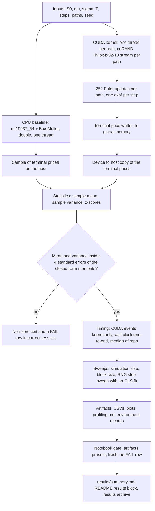

# CUDA Monte Carlo GBM Stock-Price Simulator

[](https://isocpp.org/)
[](https://developer.nvidia.com/cuda-toolkit)
[](https://www.nvidia.com/en-us/data-center/tesla-t4/)
[](https://www.kaggle.com/)

A from-scratch Monte Carlo simulator for geometric Brownian motion (GBM) stock prices: a hand-written
CUDA kernel with one thread per independent price path, a single-threaded CPU baseline, an analytical
correctness harness, and a benchmark and profiling workflow that runs end to end in one Kaggle GPU
notebook. One source file, a 70-line Makefile, no dataset and no framework.

The GBM update rule is textbook; the work here went into the measurement — separating kernel latency
from end-to-end time, validating against closed-form moments with analytical standard errors, and
backing every number in this README with an artifact in `results/`, including what could *not* be
measured in a shared container.

## Headline results

Workload: **1 000 000 paths × 252 Euler steps**, `S0=100, mu=0.05, sigma=0.20, T=1`, terminal price only.
Hardware: one Kaggle **Tesla T4** (`sm_75`, 40 SMs, 1024 threads/SM, 65536 registers/SM), driver
580.178.04, CUDA runtime 12.8. Baseline: a single-threaded CPU core (Intel Xeon @ 2.00 GHz).

| Measurement (same workload, same session) | Kernel-only, CUDA events | End-to-end, incl. alloc + copy |
|---|---|---|
| GPU, median of 5 runs | **3.442 ms** — 2.91 × 10⁸ paths/s | 4.307 ms |
| CPU, median of 3 runs | 8684.63 ms | — |
| Speedup on this device | **≈ 2523×** | ≈ 2016× |

- **Kernel-only** is the number that isolates the kernel: `cudaEventRecord` around the launch only.
  **End-to-end** adds `cudaMalloc`, the launch and the device→host copy — what a caller actually waits for.
- The ≈2523× figure is derived from that steady-state kernel row and the CPU time measured in the same
  session for the same workload. It is **not** a portable number: it is one GPU versus one CPU thread on
  this device, and a threaded or SIMD baseline would shrink it substantially.
- Correctness for the same model (200 000 paths, 3 seeds): **31 PASS, 0 FAIL, 3 skipped by design**,
  largest `\|z\| = 2.14` against a limit of 4.
- One caveat up front: the size sweep's 1 000 000-path row read **6.167 ms** because it ran before the
  T4's clocks ramped. The steady-state figure above is the primary result; both tables are kept below
  and the discrepancy is explained rather than edited away. The harness now soaks the clocks before
  any timed sweep (§ *Reproducing on Kaggle*).

## Overview

- **Model.** `S(t+dt) = S(t)·exp((mu − 0.5σ²)dt + σ√dt·Z)`, `Z ~ N(0,1)`, `dt = T/steps`; terminal
  price `S(T)` only, one GPU thread per path, 252 Euler steps per path.
- **Randomness.** cuRAND Philox4x32-10 with an independent stream per path on the GPU
  (`curand_init(seed, path_id, 0)`); `std::mt19937_64` + Box–Muller in `double` on the CPU.
- **Timing.** CUDA events for kernel-only time; wall clock for end-to-end time; medians over repeated
  runs at a fixed seed, after a warm-up.
- **Validation.** Sample mean and variance against the exact log-normal moments, scored as z-scores
  with analytical standard errors.

## Workflow



Both backends run the same path count, step count, parameters and seed policy, and the timed region is
the same simulation work on either side.

## Repository layout

```
src/gbm_montecarlo.cu                     CPU baseline + CUDA kernel + correctness + benchmark + CLI
notebooks/kaggle_gbm_montecarlo.ipynb     5-cell Kaggle workflow, embedding the source verbatim
results/                                  measured artifacts, committed as evidence
docs/validation.md                        correctness detail, audit mechanics, profiling labels
tools/                                    notebook builder, four test suites, archive auditor
Makefile                                  nvcc / g++ build and check targets
```

`src/gbm_montecarlo.cu` is deliberately one translation unit: one kernel plus one baseline, compiled
with the same parameters and driven by the same harness, so the comparison cannot drift.

## The CUDA kernel and what I implemented

`gbm_terminal_price_kernel` is the core of the project: one thread per independent path, all 252 Euler
updates in registers, one terminal store, no shared memory, no atomics, no inter-thread communication.

```cpp
__global__ void gbm_terminal_price_kernel(float* __restrict__ out, const long long n_paths,
                                         const int steps, const float S0, const float drift,
                                         const float vol, const unsigned long long seed) {
  const long long i = (long long)blockIdx.x * blockDim.x + threadIdx.x;
  if (i >= n_paths) return;                             // any path count, incl. non-multiples
  curandStatePhilox4_32_10_t st;
  curand_init(seed, (unsigned long long)i, 0ULL, &st);  // one independent stream per path
  float s = S0;
  const int pairs = steps >> 1;
#pragma unroll 4
  for (int k = 0; k < pairs; ++k) {
    const float2 z = curand_normal2(&st);               // two N(0,1) deviates per counter step
    s *= expf(drift + vol * z.x);
    s *= expf(drift + vol * z.y);
  }
  if (steps & 1) { const float z = curand_normal(&st); s *= expf(drift + vol * z); }
  out[i] = s;
}
```

| Kernel design decision | Why |
|---|---|
| one thread per path | no communication, no atomics, no shared memory: pure RNG + arithmetic |
| `curand_init(seed, path_id, 0)` | independent stream per path, and bitwise reproducibility per `(seed, paths, block)` |
| `curand_normal2` + `#pragma unroll 4` | halves RNG counter traffic and gives the compiler room to overlap the `expf` pipeline |
| `i >= n_paths` guard | arbitrary path counts, e.g. 1000 paths at block 256 leaves 24 lanes masked |
| one `cudaMalloc` + one `cudaMemcpy` | only the terminal price crosses the bus; no per-step traffic |
| explicit error check + synchronisation | a kernel fault can never be mistaken for a fast timing |

The compiled kernel uses **28 registers/thread, 0 bytes stack, 0 spill stores, no local memory**
(`-Xptxas -v`, `cuobjdump -res-usage`; `results/compile_log.txt`), so the inner loop is
register-resident — what a one-thread-per-path stencil needs.

The rest of the file is the other half of the work:

- **CPU baseline** — `std::mt19937_64` + Box–Muller (both `sin`/`cos` outputs used, so one
  `log`+`sqrt`+`sin`+`cos` block yields two deviates), all arithmetic in `double`, timed around the
  simulation loop only. Single-threaded on purpose: the comparison is one-path-at-a-time versus
  one-path-per-thread.
- **Correctness harness** — closed-form moments as the oracle, z-scores with analytical standard
  errors (the variance check uses the exact central 4th moment), determinism, lane-masking and
  empty-grid edge cases, CSV output, non-zero exit on failure.
- **Benchmark harness** — CUDA events plus wall clock, warm-up, medians, median-of-reps policy on both
  backends, and a step sweep fitted with OLS to separate launch/seeding cost from per-step cost.
- **Kaggle workflow** — compile → verify → clock soak → sweeps, then plots, profiling and a packaging
  gate that refuses to hand over an incomplete or stale result set.
- **Test suites and an archive auditor** — `docs/validation.md` lists what each one establishes;
  `make checkzip` re-derives the published numbers from a downloaded archive.

## Build and run

```bash
make                      # nvcc -O3 -std=c++17 -arch=sm_75 -Xptxas -v -lineinfo -lcurand
make ARCH=sm_60           # Tesla P100        make ARCH=sm_80   # A100
make cpu                  # CPU-only baseline, no CUDA toolkit needed, GPU columns become -1

./build/gbm smoke
./build/gbm verify --paths 200000 --seeds 3 --steps 252 --out results
./build/gbm bench  --sizes 10000,100000,1000000 --blocks 64,128,256,512 \
                   --steps 252 --reps 5 --cpu-reps 3 --ref-block 256 --out results
./build/gbm rng    --paths 1000000 --block 256 --steps 1,4,16,64,252 --reps 5 --out results
```

`make verify` / `bench` / `rng` / `smoke` / `info` wrap those commands. Checks that need no GPU at all:
`make check` (notebook validation + benchmark guard + CPU-only correctness), `make nbtest`,
`make proftest`, `make checkzip ZIP=…`.

## Correctness

`./build/gbm verify` writes `results/correctness.csv` (one row per check × backend × seed, with value,
expected, relative error, z-score, status and tolerance) and exits non-zero on any failure. The recorded
run — 200 000 paths, 252 steps, 3 seeds — reported **31 PASS, 0 FAIL, 3 skipped by design**, with
`E[S(T)] = 105.127110` against a sample mean within `|z| < 4` and a largest `|z|` of 2.14.

| Check | Backend | Tolerance |
|---|---|---|
| `output_valid` — size, all finite, all > 0 | CPU + GPU | exact |
| `mean_vs_analytic`, `variance_vs_analytic` | CPU + GPU | `\|z\| < 4`, analytical s.e. (variance from the exact central 4th moment) |
| `mean_cpu_vs_gpu` — two-sample comparison | cross | `\|z\| < 4`, `s.e. = sqrt(2)·s.e.(mean)` |
| `determinism_same_seed` / `different_seed_differs` | GPU | max difference exactly 0 / > 0 |
| `single_path`, `zero_paths`, `non_divisible_paths` | CPU + GPU | exact (masking, no launch, 1000 paths at block 256) |
| `steps_invariance` — `steps ∈ {1, 21, 252}` | GPU | `\|z\| < 4`; `E[S(T)]` must not depend on step count |

Element-by-element CPU/GPU agreement is deliberately **not** required: the backends use different
generators and precisions and draw different normal streams, so only distributional agreement is
tested, and those rows are recorded as skipped by design. Full rationale, the per-row record and the
bug the harness caught during development: `docs/validation.md`.

## Benchmarks

**Methodology.** Compile, then a warm-up run of the same geometry; **kernel-only** time from
`cudaEventRecord` around the launch with `cudaEventSynchronize`; **end-to-end** time around
`cudaMalloc` → launch → device→host copy → `cudaFree`; every repetition performs identical work (fixed
seed) and the reported value is the median (CPU 3 reps, GPU 5 reps). Speedup is `CPU time / GPU time`.
Parameters: `S0=100, mu=0.05, sigma=0.20, T=1`, 252 steps.

<!-- RESULTS:START -->
GPU: Tesla T4 (compute capability 75) | CPU: Intel(R) Xeon(R) CPU @ 2.00GHz (4 logical cores) | nvcc: /usr/local/cuda/bin/nvcc

Simulation: S0=100, mu=0.05, sigma=0.20, T=1 year, 252 steps, terminal price only;
timings are medians (CPU: 3 reps, GPU: 5 reps) from CUDA events on a single Kaggle GPU.

### CPU vs GPU over simulation size (block size 256)

| paths | steps | block | CPU ms | GPU kernel ms | GPU e2e ms | speedup (kernel) | speedup (e2e) | GPU paths/s |
|---|---|---|---|---|---|---|---|---|
| 10,000 | 252 | 256 | 86.50 | 0.074 | 0.181 | 1162.1x | 477.2x | 1.344e+08 |
| 100,000 | 252 | 256 | 875.11 | 0.650 | 0.856 | 1346.4x | 1022.1x | 1.538e+08 |
| 1,000,000 | 252 | 256 | 8684.63 | 6.167 | 6.966 | 1408.3x | 1246.7x | 1.622e+08 |

### GPU kernel time and throughput vs CUDA block size

| paths | block | GPU kernel ms | GPU e2e ms | GPU paths/s | reps |
|---|---|---|---|---|---|
| 10,000 | 64 | 0.073 | 0.199 | 1.371e+08 | 5 |
| 10,000 | 128 | 0.072 | 0.177 | 1.385e+08 | 5 |
| 10,000 | 256 | 0.074 | 0.177 | 1.355e+08 | 5 |
| 10,000 | 512 | 0.117 | 0.218 | 8.543e+07 | 5 |
| 100,000 | 64 | 0.655 | 0.858 | 1.526e+08 | 5 |
| 100,000 | 128 | 0.655 | 0.891 | 1.527e+08 | 5 |
| 100,000 | 256 | 0.649 | 0.873 | 1.540e+08 | 5 |
| 100,000 | 512 | 0.641 | 0.860 | 1.561e+08 | 5 |
| 1,000,000 | 64 | 6.178 | 7.046 | 1.619e+08 | 5 |
| 1,000,000 | 128 | 4.488 | 4.300 | 2.228e+08 | 5 |
| 1,000,000 | 256 | 3.442 | 4.307 | 2.905e+08 | 5 |
| 1,000,000 | 512 | 3.429 | 4.190 | 2.916e+08 | 5 |

### RNG setup / launch-overhead fit

```
OLS fit over the step sweep (kernel-only CUDA-event timings)
  t_ms(steps) = a + b*steps
  a = 0.029312 ms   fixed per-launch cost (kernel launch + curand_init for all 1000000 paths)
  b = 0.00985581 ms   marginal cost of one extra step for all 1000000 paths
  R^2 = 0.999984  (points = 5)
  at 252 steps: a + 252*b = 2.512977 ms, of which 1.2% is fixed setup overhead
  per-path curand_init+launch cost ~ a / n = 0.0293 ns
```

Raw data: `results/benchmark_sizes.csv`, `results/benchmark_blocks.csv`, `results/rng_overhead.csv`. Plots: `results/plot_cpu_vs_gpu_time.png`, `results/plot_block_sizes.png`, `results/plot_speedup.png`.

<!-- RESULTS:END -->

### Plots


### What the numbers say

- **Throughput, not latency.** One path is 252 serial `expf` steps, so a single thread is no faster than
  one CPU core; the GPU wins by running tens of thousands of paths at once. Steady state is
  **2.9 × 10⁸ paths/s** (1 000 000 paths, blocks 256/512). The size sweep's own 1 M row reads
  1.62 × 10⁸ paths/s because of the clock ramp below, and its 10 k/100 k rows agree with the block
  sweep to within 1% (1.34 × 10⁸ and 1.54 × 10⁸ paths/s).
- **Small sizes are overhead-bound.** At 10 000 paths the kernel takes 0.074 ms against 0.181 ms
  end-to-end, so ~60% of the wall time is launch, allocation and the copy back — which is why the
  end-to-end speedup (477×) sits far below the kernel speedup (1162×) there.
- **The 1 000 000-path size-sweep row is clock-limited.** It reports 6.167 ms where the same geometry
  later measures 3.442 ms (44% higher, 1.79× slower), and at block 128 the end-to-end time (4.300 ms)
  is *below* its own kernel time (4.488 ms) — only possible while the SM clock is still rising. So
  1408× is a floor and ≈2523× is the steady-state figure; the block-64 row (6.178 ms) carries the same
  signature and says nothing about block size. The tables are left as measured; the notebook now soaks
  the clocks before any timed sweep and repeats a sweep whose rows are still self-inconsistent.
- **Block size is second-order for this kernel.** With no shared memory or atomics it changes only
  occupancy and grid quantisation: 10 000 paths at block 512 is 20 blocks on 40 SMs, so half the device
  idles (0.117 ms against 0.074 ms at block 256); at 100 000 paths all four block sizes agree within
  2%; at 1 000 000 paths, 256 and 512 are equal (3.442 vs 3.429 ms) and about 1.3× better than 128.
  *Theoretical* occupancy is 100% at every block size tried (28 registers, no shared memory) — that is
  a derived hardware limit, not a measured utilisation; achieved occupancy is not available here.
- **Setup cost, isolated by the step sweep.** OLS over the five points gives `a = 0.029312 ms` fixed
  per-launch cost (launch + `curand_init` for 1 000 000 paths — 0.0293 ns/path) and
  `b = 0.00985581 ms` per extra Euler step at `R² = 0.999984`; at 252 steps setup is 1.2% of the
  2.512977 ms runtime. Raw points: `results/rng_overhead.csv`, `results/rng_overhead_fit.txt`.

## Profiling

The notebook tries the standard tools first and falls back to what the container allows; the whole
ladder is recorded in `results/profiling.md` with every number labelled **measured**, **static** or
**derived** (labels explained in `docs/validation.md`).

- `nsys` is not installed in the Kaggle image, and `ncu` is installed but denied GPU performance
  counters: `ERR_NVGPUCTRPERM` (verbatim in §3 and `results/ncu_stdout.txt`). **Achieved occupancy,
  cache hit rates, DRAM traffic, stall reasons and IPC are therefore not available** — no such number
  appears anywhere in this repository, and nothing is labelled a CUPTI or Nsight result unless it ran.
- What the fallback does provide: CUDA-event timing of the real kernel (4.7182 ms for 1 000 000 paths ×
  252 steps, i.e. 2.12 × 10⁸ paths/s and 252 000 000 `expf` calls = 5.34 × 10¹⁰ `expf`/s); static
  resources from the cubin (28 registers, no spills); a 920-instruction SASS census containing 29
  `MUFU` ops (11 `MUFU.EX2`), 0 `LDG` and 1 `STG`; derived occupancy (100% theoretical,
  threads-limited, 3907 blocks = 24.4 waves at 97.7 blocks/SM); and a sampled 50 ms `nvidia-smi` trace
  across a pre-soak gap and a `--reps 150` soak — SM utilisation mean 16%, median 0%, peak 70%, power
  28 W mean rising to a 76 W peak against 18 W before.
- Those views cross-check: `expf` is a hardware instruction (29 `MUFU` ops against exactly
  252 000 000 calls), the loop is register-resident (no local-memory instruction), and global traffic
  is one terminal store per path (0 `LDG`, 1 `STG`), as designed.
- The telemetry is a *sampled* counter trace, not a timeline, so it cannot show individual launches;
  and on a shared GPU `utilization.gpu` counts other tenants, so the "before" window is not guaranteed
  idle. The 0% median during the soak is real: the soak is dominated by launch and copy overhead
  between kernels, so the device idles between launches.

On a machine that permits counters: `nsys profile --stats=true -o nsys_gbm ./build/gbm bench …` and
`ncu --set full --kernel-name regex:gbm_terminal_price_kernel -o ncu_gbm ./build/gbm rng …`.

## Reproducing on Kaggle

1. New Kaggle notebook, **Settings → Accelerator → GPU** (T4 `sm_75`, or P100 `sm_60`).
2. Upload `notebooks/kaggle_gbm_montecarlo.ipynb` and **Run All** (5 cells: environment → write,
   compile, correctness → clock soak, benchmarks → plots, profiling, summary → package and hand over).
3. Cell 2 writes the embedded source, auto-detects `-arch`, compiles with `-Xptxas -v` and asserts on
   compiler or smoke-test failure, so a broken build stops in seconds rather than after the matrix (it
   falls back to the `nvidia-cuda-*-cu12` pip toolchain if `nvcc` is missing).
4. Cell 3 runs the correctness suite, then a **~25 s sustained soak of the real kernel** before any
   timed measurement, then the three sweeps. If a row is impossible (end-to-end below its kernel time)
   or the two sweeps disagree on the same geometry, it re-soaks and repeats the sweep once, keeping the
   repeat — the reason for the change and the outcome are printed into `results/bench_stdout.txt`.
5. Cells 4–5 write the CSVs, plots, `profiling.md`, `summary.md` and environment records, patch this
   README's results block, then gate the hand-over: all 16 artifacts present and non-truncated, none
   predating the session, no `FAIL` row and at least one GPU `PASS` row, `summary.md` carrying its
   tables. Kaggle has no headless download API: use the rendered `FileLink`, or **Save Version → Save &
   Run All** and the Output tab.

Runtime on a T4: ~1 s environment, ~35 s compile, ~10 s correctness, ~25 s soak, then 2–6 minutes of
benchmarks (almost all the single-threaded CPU baseline at 1 000 000 paths) plus a few seconds of
plotting. Audit a downloaded archive with `make checkzip ZIP=…` — it recomputes the OLS fit, checks
`summary.md` against the CSVs, re-derives the benchmark arithmetic, cross-checks the profiling
artifacts, validates the PNGs, and fails if the archived `src/gbm_montecarlo.cu` is not byte-identical
to the repo copy. The `results/` directory committed here is exactly the content of such an archive
(39/39 checks pass); `docs/validation.md` lists everything it verifies.

## Limitations

- The committed results come from a session that predates the clock soak, so the 1 000 000-path
  size-sweep row is ramp-limited (1408× reported, ≈2523× steady state). Re-running the notebook
  regenerates the affected rows; nothing here is extrapolated to another device.
- The CPU baseline is **single-threaded**, so the speedups are GPU-versus-one-CPU-thread figures.
- The GPU uses **`float`** (cuRAND deviates), the CPU **`double`**; fine for the stated tolerances, but
  a real precision difference. No variance reduction (no antithetic or control variates, no QMC).
- **Terminal prices only** — no path storage, Greeks or pricing.
- End-to-end time includes `cudaMalloc`/`cudaFree`, which the driver may partly amortise across
  repetitions; that is why kernel-only time is reported alongside it.
- **No hardware counters** in Kaggle, so only theoretical occupancy, static instruction counts and a
  coarse sampled telemetry trace are available; single GPU, single stream.
- GBM with constant `mu` and `sigma` is a model assumption, not a market claim.

## What this demonstrates

CUDA C++ and hand-written `__global__` kernels · thread-to-path decomposition · cuRAND device API with
per-path streams · block-size tuning driven by grid geometry · CUDA events and correct synchronisation
for measurement · launch, seeding and transfer overhead analysis via an OLS fit · statistical validation
against closed-form results with explicit tolerances · separating kernel latency from end-to-end time ·
recognising and correcting a measurement artefact instead of reporting it as kernel behaviour ·
reproducible artifact generation · honest reporting of what could not be measured.
